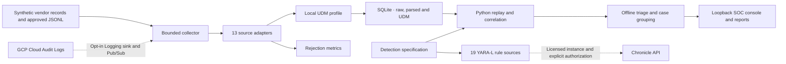

# GoogleSecOps-Lab

A local-first SOC and detection engineering laboratory for Google Cloud audit telemetry, UDM normalization and Google Security Operations rule authoring. It runs end to end on Python 3.12 and SQLite. The local evaluator runs Python reference logic. YARA-L sources are checked into Git and carry a **PENDING** native validation status.

## Architecture



| Mode | Operation | Verification |
| --- | --- | --- |
| LOCAL | Generate, ingest, normalize, replay, investigate and view the console | Executable with synthetic fixtures |
| GOOGLE_CLOUD | Collect a narrow stream of Admin Activity events through a dedicated Cloud Logging sink and Pub/Sub subscription | Terraform configuration and mock plans, mocked HTTP delivery, live verification requires an approved project |
| FUTURE_SECOPS | Chronicle raw and UDM import, rule verification and staging, deployments, detections and cases | Mocked request contracts, live verification requires a licensed instance |

## Quick start

Install Python 3.12 and [uv](https://docs.astral.sh/uv/getting-started/installation/). Run from the repository root.

```sh
uv sync --locked --python 3.12 --extra dev
uv run --no-sync secops-lab demo
uv run --no-sync secops-lab dashboard
```

Open [the local console](http://127.0.0.1:8765). Stop it with Ctrl+C. Reports are in **var/demo/** and the SQLite database is **var/lab.sqlite**. The scripts **scripts/bootstrap.ps1** and **scripts/bootstrap.sh** install dependencies and run the same demo on Windows and POSIX systems. The local runtime uses the Python standard library.

## Investigate a sensitive IAM grant

Run the IAM demo in a separate database. It compares an ordinary deployment with a sensitive role grant followed by activity from the beneficiary. The case links the grant and the observed Storage operation. The console also compares both detection strategies on 20 labeled synthetic scenarios. [IAM investigation guide](docs/iam-investigation.md)

```sh
uv run --no-sync secops-lab --db var/iam.sqlite iam-demo --out var/iam-demo
uv run --no-sync secops-lab --db var/iam.sqlite dashboard --port 8766
```

## Run a scenario and investigate

```sh
uv run --no-sync secops-lab scenarios
uv run --no-sync secops-lab generate --scenario cross --out var/cross.jsonl
uv run --no-sync secops-lab normalize var/cross.jsonl
uv run --no-sync secops-lab --db var/cross.sqlite ingest var/cross.jsonl
uv run --no-sync secops-lab --db var/cross.sqlite replay
uv run --no-sync secops-lab --db var/cross.sqlite report --out var/cross-report.json
uv run --no-sync secops-lab --db var/cross.sqlite case CASE_ID --status investigating --note "Check the federated identity" --out var/case.md
```

Replace **CASE_ID** with a complete ID from the JSON report. Use **--negative** with a specific generator scenario to produce its neighboring benign or nonmatching case. The generated reports contain provenance, case links, risk, confidence, evidence and dry-run recommendations. Existing event IDs and alert evidence IDs deduplicate on replay. See [operations and limits](docs/architecture.md).

## Detection engineering

19 use cases cover IAM, identity, endpoint, network and exfiltration behaviors. Thresholds include password spray, repeated failures, ordered failure-to-success, DNS label bursts and object reads. Cross-source correlation links a sign-in and a later IAM policy change by identity. The catalog documents ATT&CK techniques, UDM fields, blind spots, tuning and each scenario's expected outcome. [Detection reference](docs/detections.md) · [Scenario index](scenarios/catalog.json) · [Labeled outcomes](datasets/expected.json) · [Source mappings](docs/sources.md)

```sh
uv run --no-sync secops-lab validate
uv run --no-sync pytest
uv run --no-sync python scripts/sync_content.py --check
```

The suite includes a known false positive for a permitted backup. Fixture precision describes this dataset only. Native rule checks and tenant execution require Google SecOps access. [Verification report](docs/verification.md) · [YARA-L reference](https://docs.cloud.google.com/chronicle/docs/yara-l/getting-started2) · [Google sample rule repository](https://github.com/chronicle/detection-rules)

## SOC console

The console reads the current SQLite database. After the demo, open the incident queue to inspect alert evidence, enrichment and response steps. The HTTP smoke test covers the overview and case pages. Browser screenshots are pending.

## Cloud operation and cost

The cloud design uses one labeled, pre-existing lab project, a disabled-by-default audit sink, one topic and a short-lived pull subscription. The runbook covers budget setup, reviewing plans, keyless collection, harmless smoke testing and teardown. The project uses **€0 in provisioned Google Cloud resources** in local mode. Pub/Sub and log storage free allocations have eligibility and usage conditions. [Cloud runbook](docs/cloud.md)

The Chronicle adapter uses regional endpoints, Application Default Credentials and explicit write controls. The GitHub staging workflow is manual and disabled by default. [Tenant integration guide](docs/chronicle.md)
